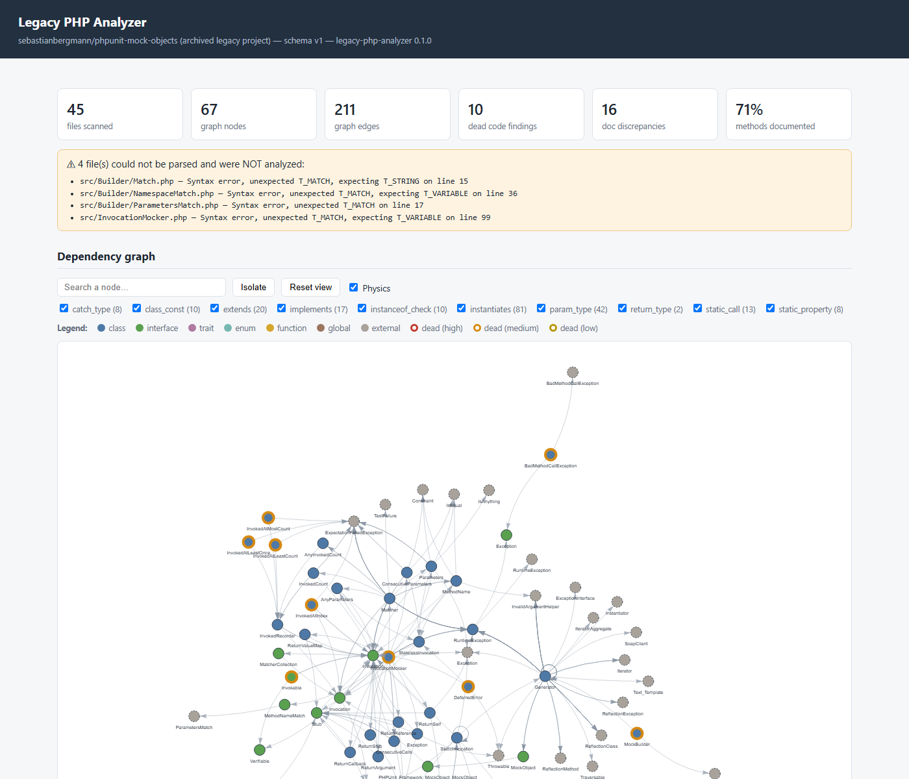
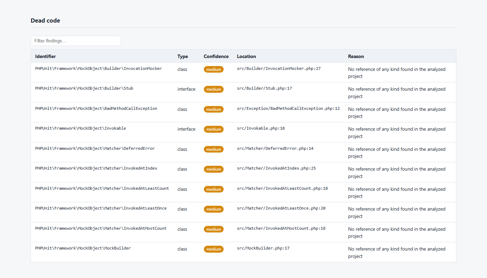
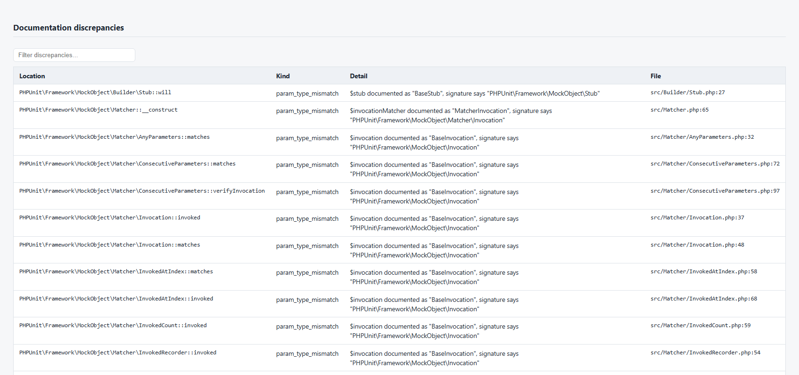

# Legacy PHP Analyzer

CLI tool that takes an **undocumented legacy PHP project** and gives you, in one run:

1. **A dependency map** between classes — inheritance, interfaces, traits, `new X()`, static calls, type hints, `catch` types, `instanceof` checks, `X::class` references.
2. **Dead code detection** — never-referenced classes, unreachable private/protected methods, never-called functions, each with an honest confidence level.
3. **Auto-generated documentation** — built from existing PHPDoc + real signatures, including detection of docblocks that lie about the code.

Output: structured **JSON** (consumable by other tools) and a **standalone interactive HTML report** with a navigable dependency graph — a single file that opens offline, no server, no build step.

> Pure PHP 8.2+, no framework. AST analysis via [nikic/php-parser](https://github.com/nikic/PHP-Parser) — no regex parsing anywhere.

---

## Screenshots

<!-- TODO: replace with real captures. Generate a report against a real
     project (e.g. an abandoned WordPress plugin), open it in a browser
     and capture:
       docs/screenshots/graph.png       — the dependency graph with the legend
       docs/screenshots/dead-code.png   — the dead code table, filtered
       docs/screenshots/discrepancies.png — doc discrepancies
-->
| Dependency graph | Dead code | Doc discrepancies |
|---|---|---|
|  |  |  |

---

## Why

Inheriting a legacy PHP codebase usually means: no docs, no tests, procedural entry points, three naming conventions, and nobody left who knows why `helpers2_old.php` exists. Before touching anything you need to know **what exists, what talks to what, and what is safe to delete**. This tool answers those three questions from static analysis alone — it never executes the analyzed code.

## Install

```bash
git clone https://github.com/<you>/legacy-php-analyzer
cd legacy-php-analyzer
composer install
```

Requires PHP ≥ 8.2 (readonly properties, enums). Also installable as a Composer dependency: the binary is declared in `bin` and autoload paths resolve both layouts.

## Usage

```bash
# JSON to stdout (machine-clean: summary goes to stderr)
php bin/analyze /path/to/legacy-project | jq .deadCode

# Everything to files, pretty JSON, full parse-error listing
php bin/analyze /path/to/legacy-project \
    --output=analysis.json --html=report.html --pretty --verbose

# Skip extra directories (ADDS to the defaults, never replaces them)
php bin/analyze /path/to/legacy-project --exclude=cache,storage

# CI gate: fail the pipeline when dead code appears
php bin/analyze src/ --fail-on-dead-code
```

### Exit codes

| Code | Meaning |
|------|---------|
| `0` | Analysis completed — findings or not, a finding is the tool working |
| `1` | Invalid usage (unknown flag, missing path) |
| `2` | Path not found / no PHP files / cannot write output |
| `3` | Dead code found — **only** with `--fail-on-dead-code` |

### JSON output

Top-level shape (`meta.schemaVersion` is bumped on breaking changes — consumers key off it instead of guessing):

```jsonc
{
  "meta":     { "schemaVersion": 1, "tool": {...}, "analyzedPath": "...",
                "generatedAt": "...", "filesScanned": 312,
                "filesWithParseErrors": 2, "excludedDirs": [...] },
  "errors":   [ { "file": "...", "message": "Syntax error ..." } ],
  "graph":    { "nodes": [...], "edges": [...] },
  "deadCode": { "classes": [...], "methods": [...], "functions": [...],
                "dynamicReferenceCounts": {...} },
  "docs":     { "coverage": {...}, "classes": [...], "functions": [...],
                "discrepancies": [...] }
}
```

## How it works

```
project dir ──► ProjectParser (php-parser + NameResolver, error-tolerant)
                   │  one AST traversal per file, two visitors:
                   ├─ SymbolCollector    → Codebase   (what EXISTS)
                   └─ DependencyVisitor  → references (what is USED)
                   ▼
                ParseResult
                   ├─► GraphBuilder      → DependencyGraph (typed edges)
                   ├─► DeadCodeDetector  → DeadCodeReport  (graph + refs)
                   ├─► DocGenerator      → DocReport       (PHPDoc + signatures)
                   ▼
                AnalysisResult ──► JsonReporter ──► analysis.json
                               └─► HtmlReporter ──► report.html (self-contained)
```

Each phase only consumes the previous phase's immutable output — the AST is never touched again after parsing.

## Design decisions worth knowing

- **`leaveNode` vs `enterNode`**: `NameResolver` resolves names as the traverser *enters* each node. A visitor reading **child** data from a class node must collect on `leaveNode` (children resolved by then); a visitor reading the node's **own** resolved names can use `enterNode`. Both patterns are used, deliberately, and commented in the code.
- **Case-insensitive symbol tables**: PHP class/function names are case-insensitive; legacy `new USER()` must match `class User`. All lookups are lowercased, original names preserved for display.
- **Static call taxonomy**: `Foo::m()` → edge with member; `Foo::$m()` → edge to the class, member unknown; `$var::m()` → **no edge**, recorded as a dynamic reference. Inventing an edge there would make the graph lie.
- **Trait dead-code closure**: a trait method's usage scope is the transitive closure over trait-uses-trait chains and consumer-class inheritance, pruned per-method by `insteadof`; an `as` alias counts as usage. Protected methods use the full hierarchy *family* (ancestors included — template-method hooks are dispatched from parent code).
- **Magic methods are never dead-code candidates**: the engine invokes them implicitly; a `private __construct` behind a static factory is a pattern, not dead code.
- **Function resolution order**: an unqualified `foo()` inside `namespace App` records candidates `[App\foo, \foo]` and only the **first declared one** counts as called — a shadowed global function is correctly reported dead.
- **Doc-type normalization before comparison**: `?string` ≡ `string|null`, `integer` ≡ `int`, `Dog[]` refines `array` (not a mismatch), `$this` ≡ `static` ≡ `self`, class names compared by short name (docblocks are never namespace-resolved). `{@inheritdoc}` is resolved through `extends → implements → traits` and the inherited doc is compared against the **override's real signature**.
- **stdout is machine-only**: JSON to stdout, every human message to stderr. `analyze proj | jq .` just works.
- **The HTML report is truly standalone**: vis-network 9.1.9 is vendored in-repo (`resources/vendor/`, provenance documented) and inlined at generation time — string concatenation, no build step, zero network on open. Embedded JSON uses `JSON_HEX_TAG`, so analyzed code containing `</script>` cannot break the report.

## Limitations (known and deliberate)

- **Flat analysis, no reachability**: calls inside a dead method still keep their targets "alive". Reachability from entry points would be stricter but requires knowing the entry points — impossible for libraries. Findings are per-symbol references, not a liveness proof.
- **Dynamic PHP is a blind spot — surfaced, not hidden**: `new $class`, `$obj->$method()`, `call_user_func`, string callables in configs are statically unresolvable. Instead of pretending, the tool counts them (`dynamicReferenceCounts`) and downgrades finding confidence (`high`/`medium`/`low`, with the concrete counter-evidence in `reason`).
- **Physical directory scan, not autoload mapping**: files are discovered by walking the tree (`.php` extension), not by resolving Composer/PSR-4 maps. Fine for legacy projects — which rarely have reliable autoload maps — but conditionally-loaded duplicated class names collide (last parsed wins).
- **Docblock class types compared by short name**: without resolving `use` statements inside docblocks, `Dog` vs `App\Dog` must be assumed equal. Trades a class of false positives for a small class of false negatives (two same-named classes in different namespaces).
- **Public symbols are never reported dead**: they may be entry points for code outside the analyzed tree. Only private/protected methods and project-local functions/classes qualify.
- **Anonymous classes** have no graph node; their dependencies are attributed to the enclosing scope.

## Testing

```bash
composer test        # PHPUnit, 74 tests / 220 assertions
```

The suite runs the real pipeline against three purpose-built fixture projects (`tests/fixtures/`): a mini legacy app with a broken file and a `vendor/` decoy, a dead-code gauntlet (trait chains, `insteadof`, template-method hooks, magic constructors), and a documentation-drift project (every discrepancy kind, plus the false-positive cases that must stay silent). The CLI is tested end-to-end through in-memory streams — exit codes, stream discipline and JSON schema included.

## License

MIT — see [LICENSE](LICENSE). The vendored vis-network bundle is MIT/Apache-2.0 dual-licensed; provenance in [resources/vendor/README.md](resources/vendor/README.md).
